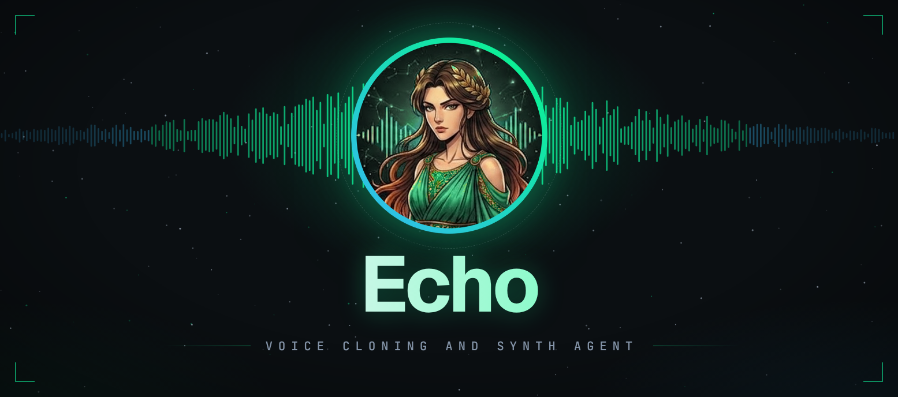
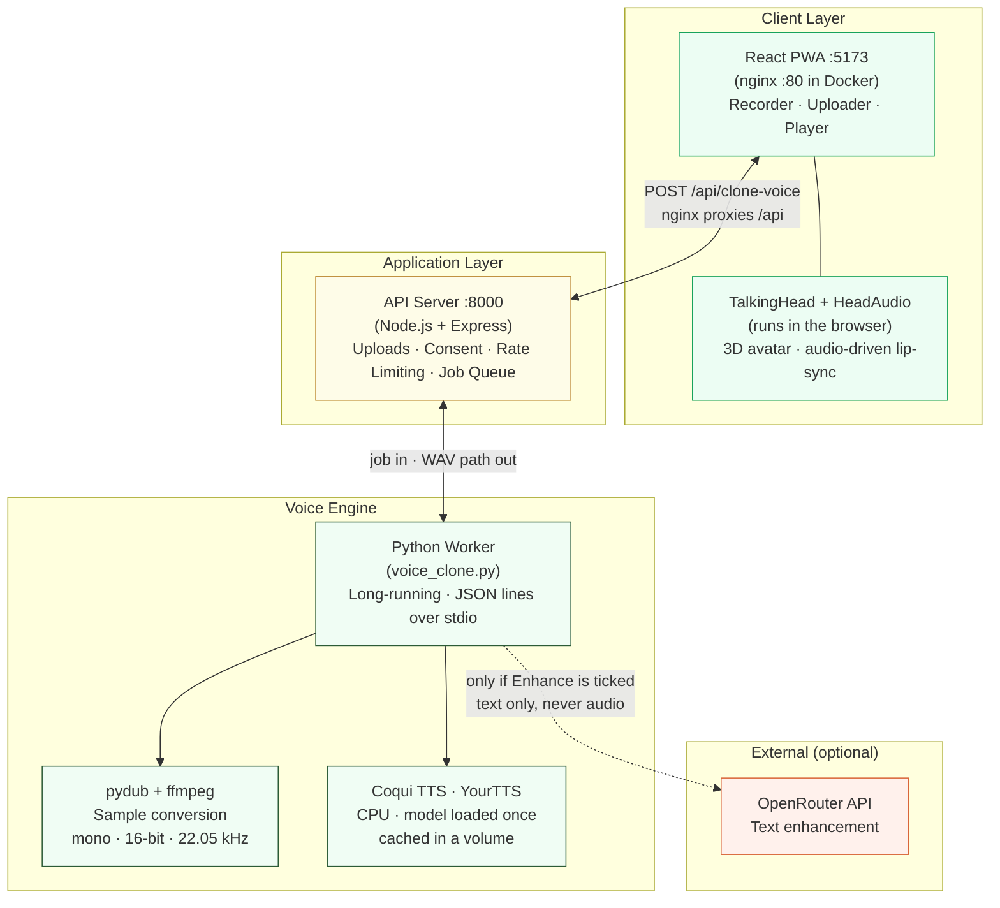

# Echo — Voice Cloning & Synth Agent



A self-hosted, containerized, mobile-first Progressive Web App that clones a voice from a short sample and speaks any text in it. An animated 3D avatar listens while you record, thinks while the voice is generated, and lip-syncs to the result. Everything runs on your own hardware (CPU only): voice samples and generated audio are never sent to a third party, and the only optional outside call is text enhancement via OpenRouter.

---

## Table of Contents

- [Architecture](#architecture)
- [Component Stack](#component-stack)
- [Consent & Safety](#consent--safety)
- [Quick Start](#quick-start)
- [Local Development (without Docker)](#local-development-without-docker)
- [Avatar](#avatar)
- [Look and Feel](#look-and-feel)
- [PWA Features](#pwa-features)
- [REST API Reference](#rest-api-reference)
- [Configuration Reference](#configuration-reference)
- [Limits and Rate Limiting](#limits-and-rate-limiting)
- [Troubleshooting](#troubleshooting)
- [Docker Container Reference](#docker-container-reference)
- [Project Structure](#project-structure)
- [Coqui TTS](#coqui-tts)
- [OpenRouter](#openrouter)
- [License](#license)

---

## Architecture



### Request Flow

1. The browser records (or uploads) a voice sample and sends it with the text to `POST /api/clone-voice`.
2. The API server validates the upload, consent and text, then queues a job for the Python worker. Jobs run one at a time.
3. The worker converts the sample with ffmpeg, optionally rewrites the text through OpenRouter, and synthesizes the speech with YourTTS.
4. The API streams the resulting WAV back and deletes every temporary file. The avatar lip-syncs to the audio as it plays.

### Component Stack

| Component | Technology | Role |
|-----------|------------|------|
| **Voice cloning** | [Coqui TTS](#coqui-tts) (`coqui-tts` fork) + YourTTS | Zero-shot voice cloning on CPU — ~425 MB model, no API cost |
| **Audio preprocessing** | [pydub](https://github.com/jiaaro/pydub) + ffmpeg | Decodes any browser or uploaded format to mono 16-bit 22.05 kHz WAV |
| **Text enhancement** | [OpenRouter](#openrouter) via the `openai` SDK | Optional rewrite of the text so it sounds natural when spoken |
| **API Server** | Node.js 20 + Express, multer, express-rate-limit | REST API, uploads, consent, rate limiting, job queue |
| **Frontend** | React 18 + TypeScript + Vite 5 + `vite-plugin-pwa` | Installable, offline-capable app shell |
| **Avatar** | [TalkingHead](https://github.com/met4citizen/TalkingHead) (three.js) + [HeadAudio](https://github.com/met4citizen/HeadAudio) | 3D avatar with audio-driven lip-sync, fully in the browser |
| **Web server** | nginx | Serves the PWA and proxies `/api` to the backend |
| **Containers** | Docker Compose | Two services and one model-cache volume |

---

## Consent & Safety

Echo can imitate a person's voice, so it ships with safeguards that are on by default.

### Safeguards

- **Consent is required.** The Generate button stays disabled until the speaker's-permission checkbox is ticked, and the server rejects any request without `consent=true`.
- **Upload validation.** One audio file only (checked by MIME type or extension), up to `MAX_UPLOAD_MB`.
- **Text limit.** At most `MAX_TEXT_LENGTH` characters per request.
- **Rate limiting.** `RATE_LIMIT_PER_MINUTE` requests per minute on the cloning endpoint.
- **Bounded jobs.** One synthesis at a time with a `JOB_TIMEOUT_SECONDS` timeout; a hung worker is killed and restarted.
- **Nothing is stored.** The uploaded sample, its converted copy and the generated WAV are deleted after every request, including failed and timed-out ones.
- **Audio stays local.** Only the text goes to OpenRouter, and only when **Enhance text** is ticked.

### Configuration

```env
# Limits (defaults shown)
MAX_UPLOAD_MB=20
MAX_TEXT_LENGTH=1000
JOB_TIMEOUT_SECONDS=600
RATE_LIMIT_PER_MINUTE=5
```

> **Responsible use:** only clone a voice you own or have permission to use. The consent checkbox is a self-declaration, not verification, and Echo does not watermark its output.

---

## Quick Start

### Prerequisites

- Docker Engine 24+ and Docker Compose v2.24+
- A few GB of free disk space (PyTorch and the ~425 MB voice model)
- Internet access on first run, to build the image and download the voice model
- *Optional:* an [OpenRouter](https://openrouter.ai) API key for text enhancement

### 1 — Configure (Optional)

```bash
cp backend/.env.example backend/.env
```

Echo runs without a `.env` file. Open it only to change a default, for example to enable text enhancement:

```env
# Free to create at https://openrouter.ai → Keys → Create Key
OPENROUTER_API_KEY=sk-or-v1-xxxxxxxxxxxxxxxx
```

### 2 — Start the Stack

```bash
docker compose up --build -d

# Follow the backend logs
docker compose logs -f backend
```

The first voice-cloning request downloads the YourTTS model (~425 MB) and loads it, so it takes noticeably longer. The model is then cached in the `tts-models` volume and kept loaded in memory, so later requests are fast: in testing on a 4-core CPU, a short sentence took about 0.5 s.

### 2a — Rebuilding After Code Changes

The voice model lives in the named volume `tts-models`, so rebuilding does not re-download it.

```bash
# Rebuild only what changed, volume untouched
docker compose up --build --force-recreate backend
docker compose up --build --force-recreate frontend
```

`docker compose down` is also safe, because it keeps named volumes. **Do not add `-v`** — that deletes the model cache and the next request downloads it again.

### 3 — Open the App

**http://localhost:5173**

### 4 — Clone a Voice

1. Record a few seconds of clear speech with **Record Audio**, or **Choose File** to upload one (WAV, MP3, M4A, OGG, WebM, FLAC…).
2. Type the text to speak. Tick **Enhance text via AI** if you set an OpenRouter key.
3. Tick the consent checkbox, then press **Generate Voice**.
4. Listen to the result, **Play Again**, or **Download Audio** as `cloned_voice.wav`.

---

## Local Development (without Docker)

Requires Node.js 20+, Python 3.10+ (tested with 3.13) and ffmpeg.

### Backend

```bash
cd backend
npm install
python3 -m venv .venv && source .venv/bin/activate

# PyTorch first: coqui-tts does not install it (CPU build shown; see pytorch.org for GPU)
pip install --index-url https://download.pytorch.org/whl/cpu torch torchaudio torchcodec
pip install -r requirements.txt

cp .env.example .env
PYTHON_BIN=.venv/bin/python npm start    # http://localhost:8000
```

`PYTHON_BIN` is only needed when the interpreter with the dependencies is not `python3` on your `PATH`.

### Frontend

```bash
cd frontend
npm install
npm run dev                              # http://localhost:5173
```

The dev server proxies `/api` to `http://localhost:8000` (override with `VITE_PROXY_TARGET`). To call the backend directly instead, set `VITE_BACKEND_URL` and allow the frontend's origin with `CORS_ORIGIN` on the backend.

`npm run build` typechecks with `tsc` and produces the production bundle in `frontend/dist`.

---

## Avatar

The avatar lives in `frontend/src/Avatar.tsx` and runs entirely in the browser. The generated audio is analysed as it plays, so the lips follow whatever the player plays, including pause and seek, and the backend does nothing extra.

| State | Trigger | Ring and waveform |
|-------|---------|-------------------|
| **Listening** | While you record; the avatar follows the microphone | Ember |
| **Thinking** | While the voice is generated | Gold, slow |
| **Speaking** | While the generated audio plays | Emerald |
| **Idle** | Otherwise | Quiet emerald |

It is loaded as a separate chunk after the page is shown. If WebGL is unavailable, the avatar is hidden and the rest of the app works as before.

### Replacing the Model

The bundled `frontend/public/avatars/generic.glb` is a placeholder: the CC0 "MPFB" sample avatar from the TalkingHead project, compressed from 37 MB to 4.6 MB. To use your own:

1. Create a GLB with a Mixamo-compatible rig plus ARKit and Oculus viseme blend shapes (see [TalkingHead, Appendix A](https://github.com/met4citizen/TalkingHead#appendix-a-create-your-own-3d-avatar)).
2. Compress it (textures to WebP, geometry with Meshopt; avoid `optimize` / `simplify`, which can break blend shapes):

   ```bash
   npx @gltf-transform/cli resize in.glb a.glb --width 1024 --height 1024
   npx @gltf-transform/cli webp a.glb b.glb
   npx @gltf-transform/cli meshopt b.glb generic.glb
   ```

3. Replace `frontend/public/avatars/generic.glb`, or change `AVATAR_URL` / `AVATAR_OPTIONS` (body type, mood, camera view) at the top of `Avatar.tsx`.

---

## Look and Feel

The interface is a dark cyberpunk HUD built from the logo's palette. All colors are CSS variables at the top of `frontend/src/index.css`, so the whole theme can be retuned in one place.

| Color | Hex | Used for |
|-------|-----|----------|
| **Void** | `#02080d` | Background |
| **Emerald** | `#34e88e` | Primary accent, success, speaking |
| **Gold** | `#d9b34a` / `#f3e58b` | Headings, Generate button, thinking |
| **Ember** | `#ff7a45` | Recording and errors only |

Fonts (Orbitron, Rajdhani, Share Tech Mono) are bundled with `@fontsource`, so the installed app works offline and nothing is loaded from a third-party CDN. Animations switch off for users who prefer reduced motion. The layout is one column on phones and two columns on desktop.

---

## PWA Features

- Installable on mobile and desktop, with icons generated from the logo
- Offline caching of the app shell, fonts, lip-sync worklet and avatar model (the avatar model is cached on first use); generating a voice still needs the backend
- Automatic updates through the service worker
- API requests are never served from the service-worker cache

---

## REST API Reference

All endpoints are public: Echo has no accounts or API keys, so keep it on a private network or behind your own authentication. Through the bundled nginx the same paths are available on port `5173`.

### Health

```bash
curl http://localhost:8000/api/health
# → { "status": "ok" }
```

### Voice Cloning

```bash
# Clone a voice and save the result
curl -X POST http://localhost:8000/api/clone-voice \
  -F "voiceSample=@/path/to/sample.wav" \
  -F "text=Hello from Echo" \
  -F "consent=true" \
  -o cloned_voice.wav

# Rewrite the text through OpenRouter first (requires OPENROUTER_API_KEY)
curl -X POST http://localhost:8000/api/clone-voice \
  -F "voiceSample=@/path/to/sample.wav" \
  -F "text=hey so this is, like, my message" \
  -F "enhance=true" \
  -F "consent=true" \
  -o cloned_voice.wav
```

Form fields (`multipart/form-data`):

| Field | Required | Description |
|-------|----------|-------------|
| `voiceSample` | Yes | Audio file up to `MAX_UPLOAD_MB` — WAV, MP3, M4A, AAC, OGG, OPUS, WebM or FLAC |
| `text` | Yes | Text to speak, up to `MAX_TEXT_LENGTH` characters |
| `consent` | Yes | Must be `true`: confirms the speaker agreed to the cloning |
| `enhance` | No | `true` to rewrite the text via OpenRouter first |

A successful request returns `200` with `Content-Type: audio/wav` and `Content-Disposition: attachment; filename="cloned_voice.wav"`.

### Errors

Errors return JSON: `{ "error": "..." }`.

| Status | Message | Cause |
|--------|---------|-------|
| `400` | `No voice sample provided` | `voiceSample` missing |
| `400` | `Please upload a single audio file as voiceSample` | Not an audio file, or more than one file |
| `400` | `Voice sample must be at most 20 MB` | Upload larger than `MAX_UPLOAD_MB` |
| `400` | `Text is required` | `text` missing or blank |
| `400` | `Text must be at most 1000 characters` | Text longer than `MAX_TEXT_LENGTH` |
| `400` | `Consent from the voice owner is required` | `consent` is not `true` |
| `429` | `Too many requests, please try again in a minute` | [Rate limit](#limits-and-rate-limiting) exceeded |
| `500` | `Voice cloning failed: …`, `Audio preprocessing failed: …`, `Voice cloning process failed` | The worker could not process the sample, or crashed |
| `500` | `Voice cloning timed out` | Job exceeded `JOB_TIMEOUT_SECONDS`; the worker is restarted |

---

## Configuration Reference

### Backend (`backend/.env`)

| Variable | Default | Description |
|----------|---------|-------------|
| `PORT` | `8000` | API server port |
| `HOST` | `0.0.0.0` | API server bind address |
| `CORS_ORIGIN` | *(all origins)* | Comma-separated allowed origins. **Set this in production** |
| `OPENROUTER_API_KEY` | — | Optional. Enables text enhancement. Create one at [openrouter.ai](https://openrouter.ai/keys) |
| `OPENROUTER_MODEL` | `openai/gpt-4o-mini` | OpenRouter model used for text enhancement |
| `TTS_MODEL_NAME` | `tts_models/multilingual/multi-dataset/your_tts` | Coqui TTS voice-cloning model |
| `MAX_UPLOAD_MB` | `20` | Largest accepted voice sample |
| `MAX_TEXT_LENGTH` | `1000` | Longest accepted text, in characters |
| `JOB_TIMEOUT_SECONDS` | `600` | Per-request synthesis timeout (covers the first-run model download) |
| `RATE_LIMIT_PER_MINUTE` | `5` | Cloning requests per minute |
| `PYTHON_BIN` | `python3` | Python interpreter used for the worker |
| `TTS_HOME` | *(Coqui default)* | Where voice models are cached. Set to `/app/models` in Docker |

### Frontend (`frontend/.env`)

| Variable | Default | Description |
|----------|---------|-------------|
| `VITE_BACKEND_URL` | *(empty)* | Empty sends `/api` through the dev server or nginx proxy. Set to call the backend directly |
| `VITE_PROXY_TARGET` | `http://localhost:8000` | Where the Vite dev server proxies `/api` |

> **Keep these in sync.** The text counter in the UI is fixed at 1000 characters (`MAX_TEXT_LENGTH` in `frontend/src/App.tsx`), and the bundled nginx accepts uploads up to 25 MB (`client_max_body_size` in `frontend/nginx.conf`). If you raise `MAX_TEXT_LENGTH` or `MAX_UPLOAD_MB` on the backend, change them there too.

---

## Limits and Rate Limiting

Echo limits what a single request can cost, because voice synthesis is CPU-heavy.

| Limit | Default | Applies to |
|-------|---------|------------|
| **Request rate** | 5 per minute | `POST /api/clone-voice` |
| **Upload size** | 20 MB | Voice sample |
| **Text length** | 1000 characters | `text` field |
| **Concurrency** | 1 job at a time | The Python worker; other requests wait their turn |
| **Job timeout** | 600 seconds | Each job; includes the first-run model download |

`GET /api/health` is not rate limited.

### How It Works

- **Rate limiting** is counted per client IP address as the API server sees it. Responses carry the standard `RateLimit` headers, and a client over the limit gets `429`.
- **Shared counter behind nginx.** In the bundled Docker setup, requests through port `5173` reach the backend via nginx, so all browsers currently share one counter. For several users, raise `RATE_LIMIT_PER_MINUTE`.
- **Timeout recovery.** A job that exceeds the timeout is answered with `500 Voice cloning timed out`, the worker process is killed and restarted, and queued requests carry on. The next request reloads the model, which takes a few seconds.
- **Cleanup.** Uploaded and generated files are removed when the request finishes, even if the client disconnects or the job fails.

### Monitoring Rate Limits

When the rate limit is exceeded:

```json
{
  "error": "Too many requests, please try again in a minute"
}
```

---

## Troubleshooting

**The first request takes a long time**

The first request downloads the YourTTS model (~425 MB) and loads it. Watch progress with:

```bash
docker compose logs -f backend
```

On a slow connection, raise `JOB_TIMEOUT_SECONDS`. If you raise it above 600, also raise `proxy_read_timeout` and `proxy_send_timeout` in `frontend/nginx.conf`.

**`Voice cloning failed` with `KeyError: 'yourtts'`**

Your `backend/.env` was copied from an older `.env.example` and still has the wrong model ID. Set it to the correct one, or delete the line to use the default:

```env
TTS_MODEL_NAME=tts_models/multilingual/multi-dataset/your_tts
```

**`Audio preprocessing failed`**

ffmpeg could not decode the sample. The Docker image includes ffmpeg; in local development install it (`apt install ffmpeg`, `brew install ffmpeg`). Otherwise try a different file or re-record.

**`Coqui TTS requires the PyTorch and Torchaudio libraries` on import**

`coqui-tts` does not install PyTorch itself. Install `torch`, `torchaudio` and `torchcodec` first, as shown in [Local Development](#local-development-without-docker).

**`429 Too many requests` although only one person is using Echo**

Behind the bundled nginx all browsers share one counter (see [Limits and Rate Limiting](#limits-and-rate-limiting)). Wait a minute or raise `RATE_LIMIT_PER_MINUTE`.

**Microphone access not working**

Browsers only allow the microphone on HTTPS or `localhost`, and the permission must be granted. If you serve Echo from another machine, put it behind HTTPS.

**The avatar does not appear, or its mouth does not move**

The avatar needs WebGL; without it the status line reads "Avatar unavailable on this device" and the rest of the app still works. Browsers also keep audio suspended until you interact with the page, so tap or click once before playing.

**CORS errors**

These only occur when `VITE_BACKEND_URL` points at the backend directly. Set `CORS_ORIGIN` on the backend to the frontend's origin.

---

## Docker Container Reference

| Service | Image | Ports | Purpose |
|---------|-------|-------|---------|
| `frontend` | Built from `frontend/` (`node:20-alpine` build, served by `nginx:alpine`) | `5173:80` | PWA and `/api` proxy |
| `backend` | Built from `backend/` (`node:20-bookworm-slim` + Python venv with CPU PyTorch) | `8000:8000` | REST API and voice-cloning worker |

| Volume | Mounted at | Purpose |
|--------|------------|---------|
| `tts-models` | `/app/models` (backend) | Downloaded voice models, kept across rebuilds |

Useful commands:

```bash
# Status and logs
docker compose ps
docker compose logs -f backend

# Re-download the voice model from scratch
docker compose down -v
```

Container names are generated by Docker Compose from the project folder (for example `echo-backend-1`).

---

## Project Structure

```
echo/
├── backend/
│   ├── index.js              # Express server + Python worker management
│   ├── voice_clone.py        # Long-running voice cloning worker (JSON lines over stdin/stdout)
│   ├── requirements.txt      # Python dependencies
│   ├── package.json
│   ├── Dockerfile
│   └── .env.example
├── frontend/
│   ├── src/
│   │   ├── App.tsx           # Main React component
│   │   ├── Avatar.tsx        # 3D avatar (TalkingHead + HeadAudio lip-sync)
│   │   ├── main.tsx          # Entry point, fonts
│   │   └── index.css         # Cyberpunk theme
│   ├── public/               # PWA icons, logo, avatars/generic.glb
│   ├── nginx.conf            # Production nginx config (SPA + /api proxy)
│   ├── vite.config.ts
│   ├── package.json
│   └── Dockerfile
├── banner.png
├── docker-compose.yml
└── README.md
```

---

## Coqui TTS

[Coqui TTS](https://github.com/idiap/coqui-ai-TTS) generates the speech. Echo uses the maintained `coqui-tts` fork (the original project is no longer maintained) and its **YourTTS** model, a zero-shot multilingual voice-cloning model that needs only a short reference clip.

- **Model:** `tts_models/multilingual/multi-dataset/your_tts` (~425 MB), downloaded on first use
- **Runs on CPU:** the Docker image installs the CPU-only PyTorch build, which keeps it much smaller than the default CUDA build
- **Output:** mono WAV at 16 kHz. Speech is generated in English
- **Cache:** the `tts-models` volume in Docker, or `TTS_HOME` locally
- **License:** the YourTTS model is **CC BY-NC-ND 4.0, non-commercial only** (see [License](#license))

### Using Another Model

Set `TTS_MODEL_NAME` in `backend/.env` to another Coqui voice-cloning model, for example `tts_models/multilingual/multi-dataset/xtts_v2`. Only YourTTS has been tested with Echo, and `xtts_v2` is released under the non-commercial CPML license.

---

## OpenRouter

[OpenRouter](https://openrouter.ai) is an optional cloud LLM gateway. When **Enhance text via AI** is ticked, Echo asks a model to rewrite the text so it sounds natural when read aloud, keeping its meaning and language. If the request fails, Echo silently speaks the original text.

- **Sign up:** https://openrouter.ai
- **API keys:** https://openrouter.ai/keys
- **Models:** any OpenRouter model ID works; the default is `openai/gpt-4o-mini`. Check OpenRouter for current pricing and free options
- **Privacy:** only the text is sent, never the voice sample or the generated audio

Configuration:

```env
OPENROUTER_API_KEY=sk-or-v1-yourkeyhere   # Leave empty to disable enhancement
OPENROUTER_MODEL=openai/gpt-4o-mini       # Model used for the rewrite
```

---

## License

Echo is released under the [MIT License](LICENSE).

Third-party components keep their own licenses:

| Component | License |
|-----------|---------|
| [TalkingHead](https://github.com/met4citizen/TalkingHead), [HeadAudio](https://github.com/met4citizen/HeadAudio) | MIT |
| three.js, React, vite-plugin-pwa | MIT |
| `coqui-tts` | MPL-2.0 |
| **YourTTS voice model** | **CC BY-NC-ND 4.0 — non-commercial use only** |
| Placeholder avatar `generic.glb` (MPFB sample) | CC0 |
| Orbitron, Rajdhani, Share Tech Mono fonts | OFL-1.1 |

> **Commercial use:** because of the YourTTS model license, using Echo's output commercially requires replacing the model with one whose license allows it.
