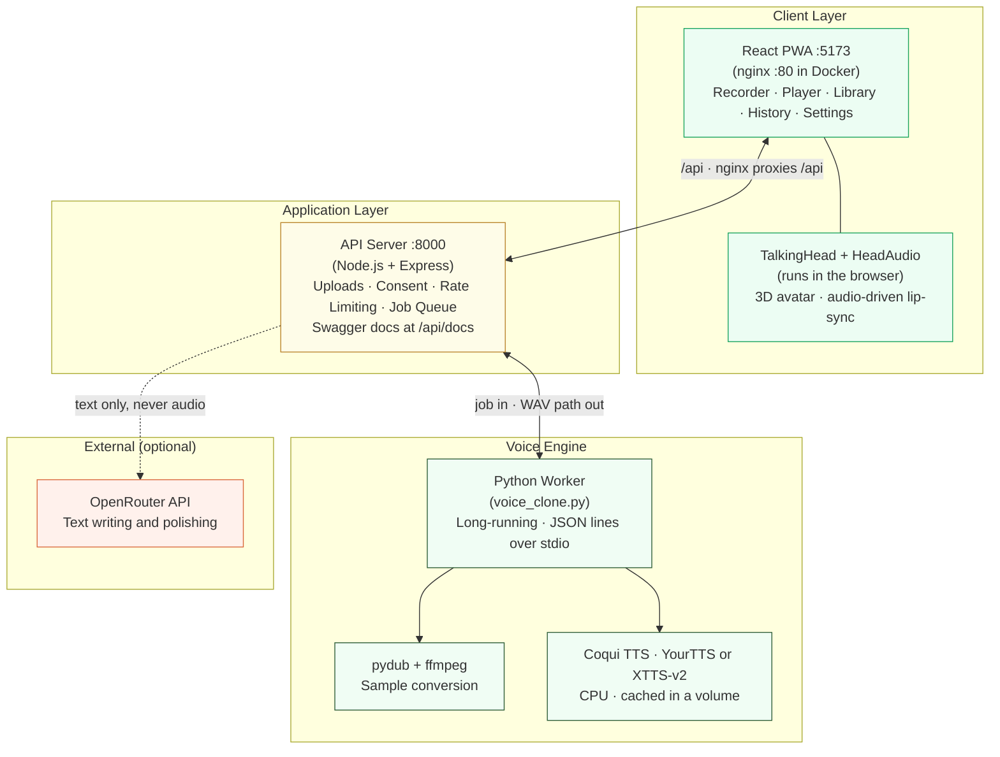

# Echo — Voice Cloning & Synth Agent


A self-hosted, containerized, mobile-first Progressive Web App that clones a voice from a short sample and speaks any text in it. Switchable voice models, an animated 3D avatar that lip-syncs to the result, and a REST API. Everything runs on your own hardware (CPU only): voice samples and generated audio are never sent to a third party.

---

## Table of Contents

- [Architecture](#architecture)
- [Component Stack](#component-stack)
- [Consent & Safety](#consent--safety)
- [Quick Start](#quick-start)
- [Voice Models](#voice-models)
- [Avatar](#avatar)
- [Settings](#settings)
- [AI Text Writing (OpenRouter)](#ai-text-writing-openrouter)
- [REST API Reference](#rest-api-reference)
- [Configuration Reference](#configuration-reference)
- [Limits and Rate Limiting](#limits-and-rate-limiting)
- [Local Development](#local-development-without-docker)
- [Troubleshooting](#troubleshooting)
- [Docker Container Reference](#docker-container-reference)
- [License](#license)

---

## Architecture



### Component Stack

| Component | Technology | Role |
|-----------|------------|------|
| **Voice cloning** | [Coqui TTS](https://github.com/idiap/coqui-ai-TTS) (`coqui-tts` fork) with YourTTS or XTTS-v2 | Zero-shot voice cloning on CPU, no API cost. [Switchable in Settings](#voice-models) |
| **Audio preprocessing** | pydub + ffmpeg | Decodes any browser or uploaded format to mono 16-bit 22.05 kHz WAV |
| **AI text** | [OpenRouter](#ai-text-writing-openrouter) | Optional: write a script from an idea, or polish wording |
| **API Server** | Node.js 20 + Express | REST API, uploads, consent, rate limiting, job queue, Swagger docs |
| **Frontend** | React 18 + TypeScript + Vite + `vite-plugin-pwa` | Installable, offline-capable app with notifications |
| **Avatar** | [TalkingHead](https://github.com/met4citizen/TalkingHead) + [HeadAudio](https://github.com/met4citizen/HeadAudio) (three.js) | 3D avatar with audio-driven lip-sync, in the browser |
| **Web server** | nginx | Serves the PWA and proxies `/api` to the backend |

**How a request flows:** the browser sends a voice sample and text to `POST /api/clone-voice`; the API validates the upload and consent and queues a job; the Python worker converts the sample and synthesizes the speech; the API streams the WAV back and deletes every temporary file; the browser keeps a copy in History and the avatar lip-syncs to it.

---

## Consent & Safety

Echo can imitate a person's voice, so these safeguards are on by default:

- **Consent is required.** The Generate button stays disabled until the speaker's-permission box is ticked, and the server rejects any request without `consent=true`.
- **Upload validation.** One audio file only, up to `MAX_UPLOAD_MB`.
- **Rate limiting and bounded jobs.** `RATE_LIMIT_PER_MINUTE` requests per minute; one synthesis at a time with a `JOB_TIMEOUT_SECONDS` timeout.
- **Nothing is stored on the server.** The sample and generated audio are deleted after every request. Library and History live only in your browser.
- **Audio stays local.** Only text goes to OpenRouter, and only when you use the AI text tools.

> **Responsible use:** only clone a voice you own or have permission to use. The consent box is a self-declaration, not verification, and Echo does not watermark its output.

---

## Quick Start

### Prerequisites

- Docker Engine 24+ and Docker Compose v2.24+
- A few GB of free disk space and internet on first run (to build the image and download the voice model)
- *Optional:* an [OpenRouter](https://openrouter.ai) API key for AI text writing

### 1 — Configure (Optional)

```bash
cp .env.example .env
```

There is one `.env` file, at the repository root, and every setting in it is optional. For example, to enable AI text writing:

```env
# Free at https://openrouter.ai → Keys → Create Key
OPENROUTER_API_KEY=sk-or-v1-xxxxxxxxxxxxxxxx
```

### 2 — Start the Stack

```bash
docker compose up --build -d

# Follow the backend logs
docker compose logs -f backend
```

The first voice request downloads the YourTTS model (~425 MB), so it takes longer. The model is cached in the `tts-models` volume, so later requests take about a second.

### 2a — Rebuilding After Code Changes

The voice model lives in the named volume `tts-models`, so rebuilding does not re-download it.

```bash
docker compose up --build --force-recreate backend frontend
```

`docker compose down` is also safe. **Do not add `-v`**: that deletes the model cache.

### 3 — Open the App

**http://localhost:5173**

### 4 — Clone a Voice

1. **Sample.** Record 20–30 seconds of the speaker reading the on-screen text, upload a WAV, MP3, M4A, OGG, WebM or FLAC file, or pick a saved voice from the **Library**. Optionally save it under a name.
2. **Script.** Type or paste the text. With an OpenRouter key you can also press **Write text** (from an idea) or **Polish wording** (rewrite what you typed; **Undo** restores it).
3. **Consent.** Tick the box and press **Synthesize audio**.

The result plays in the app, can be downloaded as WAV, and is saved in **History** (replay, reuse the text, or delete). The 50 most recent are kept.

> **Recording needs HTTPS or `localhost`.** Browsers block the microphone on plain `http://` addresses such as a LAN IP. Echo then switches you to **Upload**.

---

## Voice Models

Pick the model in **Settings → Voice model**. It applies from the next generation, with no restart, and the language list and sliders follow it.

| | YourTTS (default) | XTTS-v2 |
|---|---|---|
| Languages | English, French, Portuguese (Brazil) | 17: English, Spanish, French, German, Italian, Portuguese, Polish, Turkish, Russian, Dutch, Czech, Arabic, Chinese, Hungarian, Korean, Japanese, Hindi |
| Download | ~425 MB | a couple of GB |
| Speed on CPU | fast | slower |
| Sliders | Speed, Expressiveness, Rhythm variation | Speed, Expressiveness |
| License | CC BY-NC-ND 4.0 | Coqui Public Model License |

**Both licenses are non-commercial.** Neither model supports Filipino/Tagalog.

To use XTTS-v2: choose it in Settings, read the [Coqui license](https://coqui.ai/cpml), tick the box to accept it, and press **Use this model**. Echo never accepts the license for you. For Japanese, Korean or Chinese, also install the extra packages: `pip install 'coqui-tts[ja,ko,zh]'`, or with Docker set `XTTS_LANGUAGES=true` in `.env` and rebuild.

> XTTS-v2 support was tested with a stand-in model, because its weights could not be downloaded in the development environment. Expect to be the first to run it on real hardware.

---

## Avatar

The avatar window is always visible: at the top of the screen on phones (just below the title bar), and on the right half of wide screens. Choose **Female** or **Male** under it. It lip-syncs to any audio played in Echo: new results, History, Library and the sample preview. If WebGL is unavailable it collapses to a status line and the rest of the app works.

Precise lip-sync needs HTTPS or `localhost`; on plain `http://` it falls back to a simpler loudness-based mouth.

### Use your own avatar

Open **Settings → Avatars** and upload a `.glb` for Female or Male. Files stay in your browser. Echo checks for a Mixamo-compatible skeleton and face blend shapes, and says why if a file is rejected.

The easiest free source is [Avaturn](https://avaturn.me) (check its terms of use):

1. Create your avatar from photos.
2. In the editor, open **Body type**, press **Type** (top right), choose **TYPE 2** and press **Switch**. Type 1 has a fixed face with no blend shapes, so Echo rejects it.
3. Export as `.glb` and upload it in Settings.

Other sources: [MPFB](https://static.makehumancommunity.org/mpfb.html) for Blender (CC0, most flexible) and [VRoid Studio](https://vroid.com/en/studio) (needs conversion). Ready Player Me shut down in January 2026.

The built-in avatars are CC0 placeholders: `frontend/public/avatars/generic.glb` (female) and `male.glb`. Replace those files to change them in the source.

---

## Settings

The sliders icon (top right) opens Settings:

- **Voice model:** YourTTS or XTTS-v2 (see [Voice Models](#voice-models)).
- **Synthesizer:** speed, expressiveness, rhythm variation and text language. Saved in your browser; double-click a slider to reset it.
- **Avatars:** upload your own, with an Avaturn guide.
- **Notifications:** a browser notification when a voice is ready or fails, while Echo is in the background.
- **Install app:** install Echo on your device (Chrome, Edge; on iPhone use Share → Add to Home Screen).
- **OpenRouter:** paste an API key and choose a model, with a **Test key** button.

The OpenRouter key is saved on the server and never sent back to the browser. Echo has no accounts, so anyone who can open it can change the key and the voice model: keep it on a private network or behind your own authentication.

---

## AI Text Writing (OpenRouter)

[OpenRouter](https://openrouter.ai) powers **Write text** and **Polish wording**. Get a key at [openrouter.ai/keys](https://openrouter.ai/keys) and paste it in Settings, or set `OPENROUTER_API_KEY` in `.env`. Any OpenRouter model ID works (default `openai/gpt-4o-mini`). Only text is sent, never audio. Without a key everything else works.

---

## REST API Reference

All endpoints are public. Interactive docs are at **http://localhost:8000/api/docs** (also `/api/docs` on port 5173).

```bash
# Clone a voice and save the result
curl -X POST http://localhost:8000/api/clone-voice \
  -F "voiceSample=@sample.wav" \
  -F "text=Hello from Echo" \
  -F "consent=true" \
  -o cloned_voice.wav
```

| Endpoint | Purpose |
|----------|---------|
| `POST /api/clone-voice` | Required: `voiceSample`, `text`, `consent=true`. Optional: `language`, `speed` (0.5–2), `expressiveness` (0.1–1), `variation` (0–1.5, ignored by XTTS-v2). Returns a WAV |
| `POST /api/generate-text`, `/api/enhance-text` | AI text tools (need an OpenRouter key). Return `{ "text": "..." }` |
| `GET /api/config` | Limits, and the active voice model's languages and sliders |
| `GET`/`PUT /api/settings` | OpenRouter key and model; voice model (`ttsModel`, plus `acceptLicense` for XTTS-v2) |
| `GET /api/health` | Health check |

Errors return `{ "error": "..." }`. Status `429` means the rate limit was exceeded.

---

## Configuration Reference

Set these in the root `.env` (copy `.env.example`). Values already set in your shell take precedence.

| Variable | Default | Description |
|----------|---------|-------------|
| `OPENROUTER_API_KEY` | — | Enables the AI text tools. A key saved in Settings wins |
| `OPENROUTER_MODEL` | `openai/gpt-4o-mini` | Model for the AI text tools |
| `TTS_MODEL_NAME` | YourTTS | Starting voice model, used until one is chosen in Settings |
| `COQUI_TOS_AGREED` | — | `1` accepts the XTTS-v2 license from `.env` (or tick the box in Settings) |
| `XTTS_LANGUAGES` | `false` | Docker build only: add Japanese, Korean and Chinese packages for XTTS-v2 |
| `MAX_UPLOAD_MB` | `20` | Largest voice sample |
| `MAX_TEXT_LENGTH` | `5000` | Longest text, in characters |
| `JOB_TIMEOUT_SECONDS` | `600` | Per-request timeout, including the first model download |
| `RATE_LIMIT_PER_MINUTE` | `5` | Requests per minute to the cloning and text endpoints |
| `CORS_ORIGIN` | all | Comma-separated allowed origins. **Set this in production** |
| `PORT` / `HOST` | `8000` / `0.0.0.0` | API server address |

Less common: `TRUST_PROXY_HOPS`, `PYTHON_BIN`, `SETTINGS_FILE`, `TTS_HOME`, `VITE_BACKEND_URL`, `VITE_PROXY_TARGET` (see `.env.example`). The bundled nginx accepts uploads up to 25 MB (`frontend/nginx.conf`); raise it there if you raise `MAX_UPLOAD_MB` above that.

---

## Limits and Rate Limiting

| Limit | Default | Applies to |
|-------|---------|------------|
| **Request rate** | 5 per minute | `/api/clone-voice`, `/api/generate-text`, `/api/enhance-text` (shared counter) |
| **Upload size** | 20 MB | Voice sample |
| **Text length** | 5000 characters | `text` field and AI-written text |
| **Prompt length** | 1000 characters | `prompt` for `/api/generate-text` |
| **Concurrency** | 1 job at a time | The Python worker; other requests wait |
| **Job timeout** | 600 seconds | Each job, including the first model download |

Behind the bundled nginx all browsers share one rate-limit counter; for several users, raise `RATE_LIMIT_PER_MINUTE`. A job that times out is answered with `500`, the worker is restarted, and queued requests carry on. The server prints the limits it is really using when it starts.

---

## Local Development (without Docker)

Needs Node.js 20+, Python 3.10+ and ffmpeg.

```bash
# Backend
cd backend && npm install
python3 -m venv .venv && source .venv/bin/activate
pip install --index-url https://download.pytorch.org/whl/cpu torch torchaudio torchcodec
pip install -r requirements.txt
cp ../.env.example ../.env
PYTHON_BIN=.venv/bin/python npm start        # http://localhost:8000

# Frontend (in another terminal)
cd frontend && npm install && npm run dev    # http://localhost:5173
```

The dev server proxies `/api` to the backend. `npm run build` typechecks and builds the production bundle.

---

## Troubleshooting

**The first request is very slow.** The voice model is downloading. Watch `docker compose logs -f backend`. On a slow connection raise `JOB_TIMEOUT_SECONDS` (above 600, also raise `proxy_read_timeout` and `proxy_send_timeout` in `frontend/nginx.conf`).

**"Text must be at most 1000 characters".** An old `.env` still has `MAX_TEXT_LENGTH=1000`. Set it to `5000` or delete the line, then restart the backend.

**"XTTS-v2 is released under the Coqui Public Model License…".** Choose XTTS-v2 in Settings and tick the license box (or set `COQUI_TOS_AGREED=1` and restart).

**"this language needs an extra Python package".** Japanese, Korean and Chinese need `coqui-tts[ja,ko,zh]` (Docker: `XTTS_LANGUAGES=true`, then rebuild).

**"language … is not supported".** The current model lacks that language. Pick another in Settings, or switch the voice model.

**`KeyError: 'yourtts'`.** An old `.env` has a wrong `TTS_MODEL_NAME`. Delete the line.

**"Audio preprocessing failed".** ffmpeg could not decode the sample. Docker includes ffmpeg; locally install it. Otherwise try another file.

**429 Too many requests with one user.** Behind the bundled nginx all browsers share one counter. Wait a minute or raise `RATE_LIMIT_PER_MINUTE`.

**"This Avaturn avatar has no face blend shapes".** It is a Type 1 avatar. Switch it to Type 2 in Avaturn (see [Avatar](#use-your-own-avatar)) and export again.

**Microphone not working.** It needs HTTPS or `localhost` and granted permission. Put Echo behind HTTPS to record from other devices.

**Avatar missing or mouth not moving.** The avatar needs WebGL. Browsers also keep audio suspended until you tap or click once.

**"Text generation is not configured".** Add an OpenRouter key in Settings or `.env`.

**CORS errors.** Only when `VITE_BACKEND_URL` points directly at the backend: set `CORS_ORIGIN` to the frontend's origin.

---

## Docker Container Reference

| Service | Image | Ports | Purpose |
|---------|-------|-------|---------|
| `frontend` | Built from `frontend/` (`node:20-alpine` build, served by `nginx:alpine`) | `5173:80` | PWA and `/api` proxy |
| `backend` | Built from `backend/` (`node:20-bookworm-slim` + Python venv with CPU PyTorch) | `8000:8000` | REST API and voice-cloning worker |

| Volume | Mounted at | Purpose |
|--------|------------|---------|
| `tts-models` | `/app/models` (backend) | Downloaded voice models and saved Settings, kept across rebuilds |

```bash
docker compose ps                  # status
docker compose logs -f backend     # logs
docker compose down -v             # re-download the voice model from scratch (deletes the cache)
```

---

## License

Echo is released under the [MIT License](LICENSE). Third-party components keep their own licenses:

| Component | License |
|-----------|---------|
| [TalkingHead](https://github.com/met4citizen/TalkingHead), [HeadAudio](https://github.com/met4citizen/HeadAudio), three.js, React | MIT |
| `coqui-tts` | MPL-2.0 |
| **YourTTS voice model** | **CC BY-NC-ND 4.0, non-commercial only** |
| **XTTS-v2 voice model** (optional) | **Coqui Public Model License, non-commercial only** |
| Placeholder avatars (`generic.glb`, `male.glb`) | CC0 |
| Geist, JetBrains Mono fonts | OFL-1.1 |

> **Commercial use:** because of the model licenses, using Echo's output commercially requires replacing the model with one whose license allows it.
