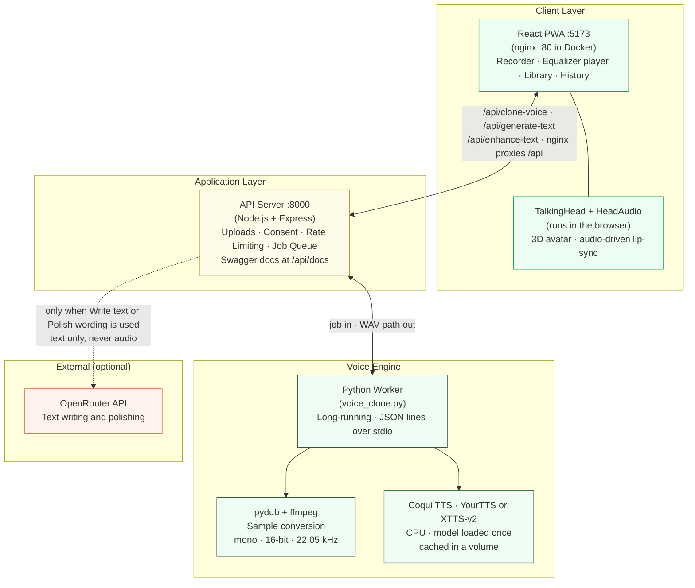

# Echo — Voice Cloning & Synth Agent


A self-hosted, containerized, mobile-first Progressive Web App that clones a voice from a short sample and speaks any text in it. An animated 3D avatar on the Synthesize page thinks while the voice is generated and lip-syncs to the result. Everything runs on your own hardware (CPU only): voice samples and generated audio are never sent to a third party, and the only optional outside calls are AI text writing and polishing via OpenRouter, which send text only.

---

## Table of Contents

- [Architecture](#architecture)
- [Component Stack](#component-stack)
- [Consent & Safety](#consent--safety)
- [Quick Start](#quick-start)
- [Local Development (without Docker)](#local-development-without-docker)
- [Avatar](#avatar)
- [Library and History](#library-and-history)
- [Settings](#settings)
- [Look and Feel](#look-and-feel)
- [PWA Features](#pwa-features)
- [REST API Reference](#rest-api-reference)
- [Configuration Reference](#configuration-reference)
- [Limits and Rate Limiting](#limits-and-rate-limiting)
- [Troubleshooting](#troubleshooting)
- [Docker Container Reference](#docker-container-reference)
- [Project Structure](#project-structure)
- [Coqui TTS](#coqui-tts)
- [OpenRouter](#openrouter)
- [License](#license)

---

## Architecture



### Request Flow

1. Optionally, the browser asks `POST /api/generate-text` to write a script from an idea, or `POST /api/enhance-text` to polish the wording. Both call OpenRouter and put the result in the text box, where you can edit it.
2. The browser records (or uploads, or picks from the library) a voice sample and sends it with the text to `POST /api/clone-voice`.
3. The API server validates the upload, consent and text, then queues a job for the Python worker. Jobs run one at a time.
4. The worker converts the sample with ffmpeg and synthesizes the speech with the voice model (YourTTS by default, or XTTS-v2).
5. The API streams the resulting WAV back and deletes every temporary file. The browser keeps a copy in its history, and the avatar lip-syncs to the audio as it plays.

### Component Stack

| Component | Technology | Role |
|-----------|------------|------|
| **Voice cloning** | [Coqui TTS](#coqui-tts) (`coqui-tts` fork) + YourTTS (default) or XTTS-v2 | Zero-shot voice cloning on CPU, no API cost. YourTTS: 3 languages, ~425 MB. XTTS-v2: 17 languages, [much larger](#choosing-the-voice-model) |
| **Audio preprocessing** | [pydub](https://github.com/jiaaro/pydub) + ffmpeg | Decodes any browser or uploaded format to mono 16-bit 22.05 kHz WAV |
| **AI text** | [OpenRouter](#openrouter) | Optional: write a script from an idea, or polish wording so it sounds natural when spoken |
| **API Server** | Node.js 20 + Express, multer, express-rate-limit, swagger-ui-express | REST API, uploads, consent, rate limiting, job queue, interactive docs |
| **Frontend** | React 18 + TypeScript + Vite 5 + `vite-plugin-pwa` | Installable, offline-capable app shell |
| **Avatar** | [TalkingHead](https://github.com/met4citizen/TalkingHead) (three.js) + [HeadAudio](https://github.com/met4citizen/HeadAudio) | 3D avatar with audio-driven lip-sync, fully in the browser |
| **Web server** | nginx | Serves the PWA and proxies `/api` to the backend |
| **Containers** | Docker Compose | Two services and one model-cache volume |

---

## Consent & Safety

Echo can imitate a person's voice, so it ships with safeguards that are on by default.

### Safeguards

- **Consent is required.** The Generate button stays disabled until the speaker's-permission checkbox is ticked, and the server rejects any request without `consent=true`.
- **Upload validation.** One audio file only (checked by MIME type or extension), up to `MAX_UPLOAD_MB`.
- **Text limit.** At most `MAX_TEXT_LENGTH` characters per request.
- **Rate limiting.** `RATE_LIMIT_PER_MINUTE` requests per minute on the cloning and text endpoints.
- **Bounded jobs.** One synthesis at a time with a `JOB_TIMEOUT_SECONDS` timeout; a hung worker is killed and restarted.
- **Nothing is stored on the server.** The uploaded sample, its converted copy and the generated WAV are deleted after every request, including failed and timed-out ones. The voice library and history live only in your own browser (see [Library and History](#library-and-history)).
- **Audio stays local.** Only text goes to OpenRouter, and only when you use **Write text** or **Polish wording**.

### Configuration

```env
# Limits (defaults shown)
MAX_UPLOAD_MB=20
MAX_TEXT_LENGTH=5000
JOB_TIMEOUT_SECONDS=600
RATE_LIMIT_PER_MINUTE=5
```

> **Responsible use:** only clone a voice you own or have permission to use. The consent checkbox is a self-declaration, not verification, and Echo does not watermark its output.

---

## Quick Start

### Prerequisites

- Docker Engine 24+ and Docker Compose v2.24+
- A few GB of free disk space (PyTorch and the ~425 MB voice model)
- Internet access on first run, to build the image and download the voice model
- *Optional:* an [OpenRouter](https://openrouter.ai) API key for AI text writing and polishing

### 1 — Configure (Optional)

```bash
cp .env.example .env
```

Echo has **one** `.env` file, at the repository root. Docker Compose, the backend and the frontend all read it. It is optional: Echo runs without it. Open it only to change a default, for example to enable AI text writing and polishing:

```env
# Free to create at https://openrouter.ai → Keys → Create Key
OPENROUTER_API_KEY=sk-or-v1-xxxxxxxxxxxxxxxx
```

### 2 — Start the Stack

```bash
docker compose up --build -d

# Follow the backend logs
docker compose logs -f backend
```

The first voice-cloning request downloads the YourTTS model (~425 MB) and loads it, so it takes noticeably longer. The model is then cached in the `tts-models` volume and kept loaded in memory, so later requests are fast: in testing on a 4-core CPU, a short sentence took about 0.5 s.

### 2a — Rebuilding After Code Changes

The voice model lives in the named volume `tts-models`, so rebuilding does not re-download it.

```bash
# Rebuild only what changed, volume untouched
docker compose up --build --force-recreate backend
docker compose up --build --force-recreate frontend
```

`docker compose down` is also safe, because it keeps named volumes. **Do not add `-v`** — that deletes the model cache and the next request downloads it again.

### 3 — Open the App

**http://localhost:5173**

### 4 — Clone a Voice

Echo has two working pages, **Sample** and **Synthesize**, plus **Library** and **History**, all reachable from the bottom dock. A progress bar at the top shows which of the three steps are done, and tapping a step jumps to its page.

**Page 1, Sample.**

1. **Voice sample.** Choose **Record**, **Upload** or **Library**.
   - *Record:* read the on-screen paragraph aloud for 20 to 30 seconds. A live meter shows your level, a progress bar shows how close you are to the goal, and recording stops by itself after a minute. Use **Retake** to try again.
   - *Upload:* any WAV, MP3, M4A, OGG, WebM or FLAC file with clear speech.
   - *Library:* reuse a voice you saved earlier.

   Once you have a sample, an equalizer player lets you listen, drag to seek, skip 10 seconds and download it. Name it and press **Save to library** to keep it, then press **Continue to script**. Leaving the page stops a recording in progress.

**Page 2, Synthesize.** It shows the avatar (switch between **Female** and **Male** under it), the chosen voice (with **Change** to go back) and the script tools.

2. **Script.** Type or paste the text. Optionally describe what you want in the AI box (for example "a 5 paragraph bedtime story about friendly monsters") and press **Write text**, or press **Polish wording** to rewrite what you typed. **Undo** restores your wording. Both need an OpenRouter key. Your script is remembered if you reload the page.
3. **Consent.** Tick the checkbox, then press **Synthesize audio**. If something is missing, a line under the button says what to do next.

While it generates, the avatar thinks and you see a timer and a **Cancel** button. The result appears in an equalizer player with **Download WAV**, and the avatar speaks it. Every result is also saved in **History**.

> **Recording needs HTTPS or localhost.** Browsers block the microphone on plain `http://` addresses such as `http://192.168.1.20:5173`. Echo then tells you so and moves you to **Upload**. See [Troubleshooting](#troubleshooting).

---

## Local Development (without Docker)

Requires Node.js 20+, Python 3.10+ (tested with 3.13) and ffmpeg.

### Backend

```bash
cd backend
npm install
python3 -m venv .venv && source .venv/bin/activate

# PyTorch first: coqui-tts does not install it (CPU build shown; see pytorch.org for GPU)
pip install --index-url https://download.pytorch.org/whl/cpu torch torchaudio torchcodec
pip install -r requirements.txt

cd .. && cp .env.example .env && cd backend   # the shared .env lives at the repository root
PYTHON_BIN=.venv/bin/python npm start    # http://localhost:8000
```

`PYTHON_BIN` is only needed when the interpreter with the dependencies is not `python3` on your `PATH`.

### Frontend

```bash
cd frontend
npm install
npm run dev                              # http://localhost:5173
```

The dev server reads the same root `.env` and proxies `/api` to `http://localhost:$PORT` (override with `VITE_PROXY_TARGET`). To call the backend directly instead, set `VITE_BACKEND_URL` and allow the frontend's origin with `CORS_ORIGIN`.

`npm run build` typechecks with `tsc` and produces the production bundle in `frontend/dist`.

---

## Avatar

The avatar lives in `frontend/src/Avatar.tsx` and runs entirely in the browser. Its window is **fixed on every page**. On a phone or a tablet held upright, the title bar with the Settings button is fixed at the very top and the avatar window sits just below it. On a wide screen or a landscape phone or tablet, the avatar takes the **right half of the screen, full height**, with the content scrolling on the left. A **Female / Male** switch in the window picks the model and body type; the choice is remembered in the browser. The avatar lip-syncs to **any audio played in Echo**: a newly generated voice, an item on the **History** or **Library** page, or the preview of your sample. The audio is analysed as it plays, so the lips follow pause and seek too, and the backend does nothing extra. Only one voice plays at a time: starting another stops the first.

| State | Trigger | Ring and waveform |
|-------|---------|-------------------|
| **Thinking** | While the voice is generated | Cyan, slow |
| **Speaking** | While any audio plays in Echo | Mint |
| **Idle** | Otherwise | Quiet mint |

It is loaded as a separate chunk after the page is shown. On a short screen, or a phone with its keyboard open, the avatar bar shrinks. If WebGL is unavailable, the window collapses to a single status line and the rest of the app works as before.

**Lip-sync quality depends on a secure connection.** Precise, viseme-based lip-sync uses an AudioWorklet, which browsers only allow on HTTPS or `localhost`. On a plain `http://` address (for example a LAN IP) Echo still shows the avatar but falls back to a simpler mouth movement that follows the loudness of the speech. Serve Echo over HTTPS for the full effect.

### Your Own Avatars

Open **Settings → Avatars** to replace the built-in female or male avatar with your own `.glb` model. The files are stored in this browser (IndexedDB) and are never uploaded; **Use default** removes one. The avatar on the Synthesize page reloads as soon as you save.

Echo checks a file before accepting it, because TalkingHead needs a specific structure. A file is rejected, with a message saying why, if it:

- is not a binary glTF 2.0 (`.glb`) file, or is larger than 60 MB
- lacks the Mixamo-compatible skeleton (`Hips`, `Spine`, arms, hands, fingers, legs and toes; a `mixamorig` prefix is fine)
- has no blend shapes (morph targets)

A model without lip-sync shapes (`viseme_aa` or `jawOpen`) is accepted with a warning: it loads, but its mouth will not move. If a saved file passes these checks but still fails to load (for example because it is truncated), Echo shows the built-in avatar and says so. To make a compatible model, follow the steps under [Replacing the Models](#replacing-the-models).

### Where to Get Avatars

| Source | Cost | Notes |
|--------|------|-------|
| [Avaturn](https://avaturn.me) | Free for non-commercial use, according to TalkingHead's documentation (check Avaturn's current terms) | Makes a realistic avatar from a photo. Choose a **Type-2 (T2)** avatar, the one TalkingHead documents as compatible: in the editor open **Body type**, press **Type** (top right), pick **TYPE 2** and press **Switch**. A sample Avaturn export passes Echo's upload checks and loads and animates in the app. Avaturn's **Type 1 (T1)** avatars have a fixed face with no blend shapes, so Echo rejects them |
| [MPFB](https://static.makehumancommunity.org/mpfb.html) for Blender | Free, CC0 output | The most flexible, and how the bundled avatars started. Needs Blender; follow [TalkingHead's MPFB guide](https://github.com/met4citizen/TalkingHead/blob/main/blender/MPFB/MPFB.md) |
| [VRoid Studio](https://vroid.com/en/studio) | Free, permissive terms | Anime style. Its files must first be converted to TalkingHead's format in Blender, using [this guide](https://github.com/met4citizen/TalkingHead/blob/main/blender/VRoid/VROID.md) |
| [Avatar SDK (MetaPerson)](https://avatarsdk.com) | Commercial service | Realistic avatars from photos. Needs TalkingHead's conversion scripts |
| Ready Player Me | — | **Shut down on 31 January 2026**: its avatar creator is offline, so do not rely on it |

Whatever you use, check its terms of use: many avatar services forbid avatars that a public web app delivers to the browser.

### Replacing the Models

These steps are for changing the **built-in** avatars in the source code, or for preparing a model to upload in Settings. The female avatar is `frontend/public/avatars/generic.glb` and the male one is `frontend/public/avatars/male.glb`. If `male.glb` is missing, choosing Male shows the female model with the male body type (and a note says so). Any model that meets the requirements below works, and you can point `MODEL_URLS` at the top of `Avatar.tsx` to other files.

Both bundled avatars are generic placeholders, meant to be replaced:

- `generic.glb` (female) is the CC0 "MPFB" sample avatar from the TalkingHead project, compressed from 37 MB to 4.6 MB.
- `male.glb` is that same model reshaped into a male body with MakeHuman's own CC0 gender targets: broader shoulders and a stronger jaw, heavier brows, a warmer skin tone, and every bone moved to match with its rotations untouched, so the rig, the lip-sync shapes and all poses behave exactly like the female one. It is 4.5 MB, and CC0 like its source.

The male model is a rough first version. The hair keeps a small tuft at the back where the original ponytail was cut away, the shirt still has a faint female chest line, and the face is the female face reshaped rather than a new design. Replace it in Settings, or by swapping the file, when you have something better.

To use your own:

1. Create a GLB with a Mixamo-compatible rig plus ARKit and Oculus viseme blend shapes (see [TalkingHead, Appendix A](https://github.com/met4citizen/TalkingHead#appendix-a-create-your-own-3d-avatar)).
2. Compress it (textures to WebP, geometry with Meshopt; avoid `optimize` / `simplify`, which can break blend shapes):

   ```bash
   npx @gltf-transform/cli resize in.glb a.glb --width 1024 --height 1024
   npx @gltf-transform/cli webp a.glb b.glb
   npx @gltf-transform/cli meshopt b.glb generic.glb
   ```

3. Save it as `frontend/public/avatars/male.glb` (or `generic.glb` for the female avatar), or change `MODEL_URLS` at the top of `Avatar.tsx`.

---

## Library and History

Both live in your browser's IndexedDB. Nothing is uploaded or stored on the server, and clearing the site's data in the browser deletes them.

- **Library.** Save any recorded or uploaded sample under a name, then reuse it from the **Library** source on the Sample page or from the **Library** page (where **Use voice** jumps straight to Synthesize). Each voice has an equalizer player, **Use voice**, **Download** and **Delete**.
- **History.** Every generated voice is saved automatically with its text, the voice used and the time. Replay or download it, **Reuse text** to send the text back to the script box, or delete entries. The 50 most recent are kept.

---

## Look and Feel

The interface follows the "Obsidian Waveform" design system in `DESIGN.md`: dark glass cards over a carbon background, with luminous accents used only for interactive and live states. All colors are CSS variables at the top of `frontend/src/index.css`, so the whole theme can be retuned in one place.

| Color | Hex | Used for |
|-------|-----|----------|
| **Obsidian** | `#0B0F12` | Background |
| **Mint** | `#10F49C` | Primary actions, played audio, speaking |
| **Emerald** | `#00DC82` | Focus borders, secondary actions |
| **Cyan** | `#38BDF8` | AI text tools, thinking |
| **Red** | `#F87171` | Recording and errors only |

It is built for phones first: a single column under the fixed avatar bar, a floating bottom dock (Sample, Synthesize, Library, History), and on wide screens a split page with the content on the left and the avatar on the right, and an equalizer-style player where the bars fill as audio plays and dragging them seeks. Fonts (Geist and JetBrains Mono) are bundled with `@fontsource`, so the installed app works offline and nothing is loaded from a third-party CDN. Animations switch off for users who prefer reduced motion.

---

## Settings

The sliders icon in the top-right corner opens the Settings page.

**Synthesizer** (saved in this browser, applied to every voice you generate; double-click a slider to reset it):

| Setting | Effect |
|---------|--------|
| **Speed** | How fast the voice speaks, 0.6× to 1.5× |
| **Expressiveness** | How much pitch and tone vary. Lower is steadier and flatter, higher is livelier but less predictable |
| **Rhythm variation** | How much timing and pauses vary |
| **Language of the text** | The languages of the voice model in use: English, French and Portuguese (Brazil) for YourTTS, 17 languages for XTTS-v2. The list follows the model automatically |

Only sliders you moved are sent to the server; untouched ones leave the model's own defaults in place. With YourTTS these map to the VITS length, noise and duration-noise scales. With XTTS-v2, **Speed** is its `speed` and **Expressiveness** is its sampling temperature, and **Rhythm variation** is hidden because XTTS-v2 has no equivalent. Saved slider values belong to the model they were set for: when you switch models, they start again from the new model's defaults. Pitch is not offered because neither model has a pitch control.

**Avatars** uploads your own female and male 3D avatars (see [Your Own Avatars](#your-own-avatars)). It links to [Avaturn](https://avaturn.me) and has a short step-by-step guide for making a free avatar there.

**Notifications** turns on a browser notification for when a voice is ready or fails, with a **Send a test** button. See [Notifications and Installing](#notifications-and-installing).

**Install app** installs Echo on your device when the browser allows it.

**OpenRouter** lets you paste an API key and choose a model, with a **Test key** button. The key is saved on the server in `echo-settings.json` next to the voice models, so it survives rebuilds, and it is **never sent back to the browser** (only the last four characters are shown). A key saved here overrides `OPENROUTER_API_KEY` in `.env`. Because Echo has no accounts, anyone who can open the app can replace the key: keep Echo on a private network.

**Developers** links to the [Swagger docs](#interactive-docs-swagger).

---

## PWA Features

- Installable on mobile and desktop, with icons generated from the logo, and an **Install now** prompt while it is not installed
- Notifications when a voice is ready or fails (see below)
- Offline caching of the app shell, fonts, lip-sync worklet and avatar model (the avatar model is cached on first use); generating a voice still needs the backend
- Automatic updates through the service worker
- API requests are never served from the service-worker cache

### Notifications and Installing

**Install prompt.** While Echo is not installed, a banner offers **Install now** (and **Not now**, which hides it for two weeks). It uses the browser's own install dialog, so it appears only where the browser supports installing: Chrome, Edge and other Chromium browsers. On iPhone and iPad there is no install dialog, so the banner explains **Share → Add to Home Screen** instead. The same option is always available under **Settings → Install app**. Installing requires HTTPS (or `localhost`).

**Notifications.** Turn them on under **Settings → Notifications**, or with **Notify me when it is done** while a voice is generating. Echo then sends a notification when a voice is ready, or fails, **only while it is in the background** (another tab or window), never while you are looking at it. Clicking the notification brings Echo to the front. The same applies to the AI text tools, **Write text** and **Polish wording**. Notifications need HTTPS (or `localhost`); on iPhone and iPad they work once Echo is added to the home screen (iOS 16.4 or later).

> **Limits.** These are local notifications: the page shows them itself, and nothing goes through a push server. They work while the browser keeps Echo running in the background. If you close the browser, or your phone puts it to sleep, the request is interrupted and no notification is sent. Notifying with the app closed would need real Web Push, which requires the server to keep generation jobs running on its own and to hold push subscriptions; Echo does not do that today.

---

## REST API Reference

All endpoints are public: Echo has no accounts or API keys, so keep it on a private network or behind your own authentication. Through the bundled nginx the same paths are available on port `5173`.

### Health

```bash
curl http://localhost:8000/api/health
# → { "status": "ok" }
```

### Configuration

```bash
curl http://localhost:8000/api/config
# → { "maxTextLength": 5000, "maxPromptLength": 1000, "maxUploadMb": 20 }
```

The limits the server is actually enforcing. The web app reads them from here instead of assuming its own. The server also prints them when it starts (`Limits: text 5000 chars, …`), which is the quickest way to see what `.env` really set.

### Interactive Docs (Swagger)

Open **http://localhost:8000/api/docs** (or `/api/docs` on port `5173`) for a browsable, try-it-out description of every endpoint. The raw OpenAPI document is at `/api/openapi.json`.

### Voice Cloning

```bash
# Clone a voice and save the result
curl -X POST http://localhost:8000/api/clone-voice \
  -F "voiceSample=@/path/to/sample.wav" \
  -F "text=Hello from Echo" \
  -F "consent=true" \
  -o cloned_voice.wav
```

Form fields (`multipart/form-data`):

| Field | Required | Description |
|-------|----------|-------------|
| `voiceSample` | Yes | Audio file up to `MAX_UPLOAD_MB` — WAV, MP3, M4A, AAC, OGG, OPUS, WebM or FLAC |
| `text` | Yes | Text to speak, up to `MAX_TEXT_LENGTH` characters |
| `consent` | Yes | Must be `true`: confirms the speaker agreed to the cloning |
| `language` | No | Language of the text: `en` (default). Must be one the active model supports: `en`, `fr-fr` or `pt-br` for YourTTS; `en`, `es`, `fr`, `de`, `it`, `pt`, `pl`, `tr`, `ru`, `nl`, `cs`, `ar`, `zh-cn`, `hu`, `ko`, `ja` or `hi` for XTTS-v2. `GET /api/config` lists them |
| `speed` | No | `0.5` to `2`. `1` is the model default, higher is faster |
| `expressiveness` | No | `0.1` to `1`. Lower sounds steadier and flatter |
| `variation` | No | `0` to `1.5`. How much rhythm and pauses vary. Ignored by XTTS-v2 |
| `enhance` | No | `true` to rewrite the text via OpenRouter first. The Echo app no longer sends this and uses `/api/enhance-text` instead |

A successful request returns `200` with `Content-Type: audio/wav` and `Content-Disposition: attachment; filename="cloned_voice.wav"`.

### Text Writing

Both endpoints need an OpenRouter key (saved on the Settings page or set as `OPENROUTER_API_KEY`) and share the cloning rate limit. They return `{ "text": "..." }`, at most `MAX_TEXT_LENGTH` characters.

```bash
# Write a script from an idea (prompt up to 1000 characters)
curl -X POST http://localhost:8000/api/generate-text \
  -H "Content-Type: application/json" \
  -d '{"prompt": "Write me a 5 paragraph bedtime short story about friendly monsters"}'

# Rewrite existing text so it sounds natural when spoken
curl -X POST http://localhost:8000/api/enhance-text \
  -H "Content-Type: application/json" \
  -d '{"text": "hey so this is, like, my message"}'
```

### Settings

```bash
curl http://localhost:8000/api/settings          # key status, model, tuning ranges (never the key itself)

curl -X PUT http://localhost:8000/api/settings   -H "Content-Type: application/json"   -d '{"openrouterApiKey": "sk-or-v1-...", "openrouterModel": "openai/gpt-4o-mini"}'   # "" removes a saved value

curl -X POST http://localhost:8000/api/settings/test -H "Content-Type: application/json" -d '{}'   # checks the saved key
```

### Errors

Errors return JSON: `{ "error": "..." }`.

| Status | Message | Cause |
|--------|---------|-------|
| `400` | `No voice sample provided` | `voiceSample` missing |
| `400` | `Please upload a single audio file as voiceSample` | Not an audio file, or more than one file |
| `400` | `Voice sample must be at most 20 MB` | Upload larger than `MAX_UPLOAD_MB` |
| `400` | `Text is required` | `text` missing or blank |
| `400` | `Prompt is required`, `Prompt must be at most 1000 characters` | Missing or too long `prompt` on `/api/generate-text` |
| `400` | `Text must be at most 5000 characters` | Text longer than `MAX_TEXT_LENGTH` |
| `400` | `Consent from the voice owner is required` | `consent` is not `true` |
| `429` | `Too many requests, please try again in a minute` | [Rate limit](#limits-and-rate-limiting) exceeded |
| `500` | `Voice cloning failed: …`, `Audio preprocessing failed: …`, `Voice cloning process failed` | The worker could not process the sample, or crashed |
| `500` | `Voice cloning timed out` | Job exceeded `JOB_TIMEOUT_SECONDS`; the worker is restarted |
| `502` | `Text generation failed, please try again` | OpenRouter returned an error or nothing |
| `503` | `Text generation is not configured: add an OpenRouter API key in Settings` | No OpenRouter key on the server |
| `400` | `speed must be a number between 0.5 and 2` (and similar) | A tuning field is out of range |

---

## Configuration Reference

All settings live in a single `.env` file at the repository root (copy `.env.example`). Values already set in your shell take precedence over the file.

> **Upgrading:** earlier versions read `backend/.env` and `frontend/.env`, which are now ignored. Move your values into the root file, for example `mv backend/.env .env`, and delete `frontend/.env`.

### Backend

| Variable | Default | Description |
|----------|---------|-------------|
| `PORT` | `8000` | API server port |
| `HOST` | `0.0.0.0` | API server bind address |
| `CORS_ORIGIN` | *(all origins)* | Comma-separated allowed origins. **Set this in production** |
| `OPENROUTER_API_KEY` | — | Optional. Enables **Write text** and **Polish wording**. Create one at [openrouter.ai](https://openrouter.ai/keys). A key saved on the [Settings](#settings) page takes precedence |
| `OPENROUTER_MODEL` | `openai/gpt-4o-mini` | OpenRouter model used for writing and polishing text |
| `TTS_MODEL_NAME` | `tts_models/multilingual/multi-dataset/your_tts` | Starting voice model, used until one is chosen in Settings (then the Settings choice wins). Use `tts_models/multilingual/multi-dataset/xtts_v2` for 17 languages (see [Choosing the voice model](#choosing-the-voice-model)) |
| `COQUI_TOS_AGREED` | *(unset)* | Set to `1` to accept the XTTS-v2 license from `.env`. **XTTS-v2 will not run without the license accepted** (here or with the box in Settings), and Echo cannot accept it for you |
| `XTTS_LANGUAGES` | `false` | Docker build only. `true` also installs the packages XTTS-v2 needs for Japanese, Korean and Chinese |
| `MAX_UPLOAD_MB` | `20` | Largest accepted voice sample |
| `MAX_TEXT_LENGTH` | `5000` | Longest accepted text, in characters |
| `JOB_TIMEOUT_SECONDS` | `600` | Per-request synthesis timeout (covers the first-run model download) |
| `RATE_LIMIT_PER_MINUTE` | `5` | Requests per minute to the cloning and text endpoints |
| `TRUST_PROXY_HOPS` | `1` | Reverse proxies in front of the API (the bundled nginx is one). Used to find the real client IP for rate limiting |
| `PYTHON_BIN` | `python3` | Python interpreter used for the worker |
| `SETTINGS_FILE` | `backend/models/echo-settings.json` | Where Settings-page values (OpenRouter key and model) are saved. In Docker this sits in the `tts-models` volume |
| `TTS_HOME` | *(Coqui default)* | Where voice models are cached. Set to `/app/models` in Docker |

### Frontend

Only variables starting with `VITE_` are exposed to the browser, so secrets such as `OPENROUTER_API_KEY` never reach the bundle. These two apply to `npm run dev` and local builds; the Docker image is built without the root `.env` and always uses the nginx `/api` proxy.

| Variable | Default | Description |
|----------|---------|-------------|
| `VITE_BACKEND_URL` | *(empty)* | Empty sends `/api` through the dev server or nginx proxy. Set to call the backend directly |
| `VITE_PROXY_TARGET` | `http://localhost:$PORT` | Where the Vite dev server proxies `/api` |

> **Upload size.** The bundled nginx accepts uploads up to 25 MB (`client_max_body_size` in `frontend/nginx.conf`). If you raise `MAX_UPLOAD_MB` above that, raise it there too. The text and prompt limits need no matching change: the web app reads them from the server (`/api/config`).

---

## Limits and Rate Limiting

Echo limits what a single request can cost, because voice synthesis is CPU-heavy.

| Limit | Default | Applies to |
|-------|---------|------------|
| **Request rate** | 5 per minute | `POST /api/clone-voice`, `/api/generate-text`, `/api/enhance-text` (shared counter) |
| **Upload size** | 20 MB | Voice sample |
| **Text length** | 5000 characters | `text` field and AI-written text |
| **Prompt length** | 1000 characters | `prompt` for `/api/generate-text` |
| **Concurrency** | 1 job at a time | The Python worker; other requests wait their turn |
| **Job timeout** | 600 seconds | Each job; includes the first-run model download |

`GET /api/health` is not rate limited.

### How It Works

- **Rate limiting** is counted per client IP address as the API server sees it. Responses carry the standard `RateLimit` headers, and a client over the limit gets `429`.
- **Shared counter behind nginx.** In the bundled Docker setup, requests through port `5173` reach the backend via nginx, so all browsers currently share one counter. For several users, raise `RATE_LIMIT_PER_MINUTE`.
- **Timeout recovery.** A job that exceeds the timeout is answered with `500 Voice cloning timed out`, the worker process is killed and restarted, and queued requests carry on. The next request reloads the model, which takes a few seconds.
- **Cleanup.** Uploaded and generated files are removed when the request finishes, even if the client disconnects or the job fails.

### Monitoring Rate Limits

When the rate limit is exceeded:

```json
{
  "error": "Too many requests, please try again in a minute"
}
```

---

## Troubleshooting

**The first request takes a long time**

The first request downloads the YourTTS model (~425 MB) and loads it. Watch progress with:

```bash
docker compose logs -f backend
```

On a slow connection, raise `JOB_TIMEOUT_SECONDS`. If you raise it above 600, also raise `proxy_read_timeout` and `proxy_send_timeout` in `frontend/nginx.conf`.

**"Text must be at most 1000 characters" although the code allows more**

A value in your `.env` overrides the built-in default. If you created `.env` from an older `.env.example`, it may still contain `MAX_TEXT_LENGTH=1000`. Set it to `5000` (or delete the line), then restart the backend. The first lines the server prints when it starts show the limits it is really using (`Limits: text 1000 chars, …`), and the counter under the script box follows them.

**"XTTS-v2 is released under the Coqui Public Model License…" when generating a voice**

XTTS-v2 is selected (with `TTS_MODEL_NAME`), but its license has not been accepted. Read the [license](https://coqui.ai/cpml) and, if you accept it, choose XTTS-v2 in Settings and tick the license box (or add `COQUI_TOS_AGREED=1` to `.env` and restart the backend).

**"this language needs an extra Python package" with XTTS-v2**

Japanese, Korean and Chinese need extra packages. Install them with `pip install 'coqui-tts[ja,ko,zh]'`, or with Docker set `XTTS_LANGUAGES=true` in `.env` and rebuild the image.

**"language … is not supported by …"**

The language you chose isn't one the current voice model knows (for example `es` with YourTTS). Pick one from the list in Settings, or switch the model: see [Choosing the voice model](#choosing-the-voice-model).

**`Voice cloning failed` with `KeyError: 'yourtts'`**

Your `.env` was copied from an older `.env.example` and still has the wrong model ID. Set it to the correct one, or delete the line to use the default:

```env
TTS_MODEL_NAME=tts_models/multilingual/multi-dataset/your_tts
```

**`Audio preprocessing failed`**

ffmpeg could not decode the sample. The Docker image includes ffmpeg; in local development install it (`apt install ffmpeg`, `brew install ffmpeg`). Otherwise try a different file or re-record.

**`Coqui TTS requires the PyTorch and Torchaudio libraries` on import**

`coqui-tts` does not install PyTorch itself. Install `torch`, `torchaudio` and `torchcodec` first, as shown in [Local Development](#local-development-without-docker).

**`429 Too many requests` although only one person is using Echo**

Behind the bundled nginx all browsers share one counter (see [Limits and Rate Limiting](#limits-and-rate-limiting)). Wait a minute or raise `RATE_LIMIT_PER_MINUTE`.

**"This Avaturn avatar has no face blend shapes" when uploading an avatar**

The file is a Type 1 (T1) Avaturn avatar. Avaturn's docs describe T1 as the fixed-face type, with no blend shapes, so nothing can move its mouth. Type 2 (T2) avatars have separate eyeballs and a mouth that can be animated with ARKit blend shapes and visemes. In Avaturn's editor, open **Body type**, press **Type**, choose **TYPE 2** and press **Switch**, then export again. Or use another source from [Where to Get Avatars](#where-to-get-avatars).

**Microphone access not working**

Browsers only allow the microphone on HTTPS or `localhost`, and the permission must be granted. Opening Echo through a LAN address such as `http://192.168.1.20:5173` is *not* secure, so recording is blocked: Echo says so and switches to **Upload**. Put Echo behind HTTPS (for example a reverse proxy with a certificate) to record from other devices. For a quick test on the same machine, use `http://localhost:5173`.

**The avatar does not appear, or its mouth does not move**

The avatar needs WebGL; without it the status line reads "Avatar unavailable on this device" and the rest of the app still works. On a plain `http://` address other than `localhost` the avatar still appears but uses a simpler loudness-based mouth, because precise lip-sync needs HTTPS (see [Avatar](#avatar)). Browsers also keep audio suspended until you interact with the page, so tap or click once before playing.

**`Text generation is not configured`**

**Write text** and **Polish wording** need an OpenRouter key. Paste it on the Settings page (no restart needed), or set `OPENROUTER_API_KEY` in the root `.env` and restart the backend.

**CORS errors**

These only occur when `VITE_BACKEND_URL` points at the backend directly. Set `CORS_ORIGIN` on the backend to the frontend's origin.

---

## Docker Container Reference

| Service | Image | Ports | Purpose |
|---------|-------|-------|---------|
| `frontend` | Built from `frontend/` (`node:20-alpine` build, served by `nginx:alpine`) | `5173:80` | PWA and `/api` proxy |
| `backend` | Built from `backend/` (`node:20-bookworm-slim` + Python venv with CPU PyTorch) | `8000:8000` | REST API and voice-cloning worker |

| Volume | Mounted at | Purpose |
|--------|------------|---------|
| `tts-models` | `/app/models` (backend) | Downloaded voice models, kept across rebuilds |

Useful commands:

```bash
# Status and logs
docker compose ps
docker compose logs -f backend

# Re-download the voice model from scratch
docker compose down -v
```

Container names are generated by Docker Compose from the project folder (for example `echo-backend-1`).

---

## Project Structure

```
echo/
├── backend/
│   ├── index.js              # Express server, text endpoints + Python worker management
│   ├── openapi.js            # OpenAPI description served at /api/docs
│   ├── settings.js           # OpenRouter key and model saved from the Settings page
│   ├── voice_clone.py        # Long-running voice cloning worker (JSON lines over stdin/stdout)
│   ├── requirements.txt      # Python dependencies
│   ├── package.json
│   └── Dockerfile
├── frontend/
│   ├── src/
│   │   ├── App.tsx           # Sample and Synthesize pages, tabs and dock
│   │   ├── Avatar.tsx        # 3D avatar (TalkingHead + HeadAudio lip-sync)
│   │   ├── Settings.tsx      # Settings page (synthesizer, OpenRouter, API docs link)
│   │   ├── api.ts            # API base URL and browser-stored settings
│   │   ├── WaveformPlayer.tsx # Equalizer-style audio player
│   │   ├── LiveMeter.tsx     # Level bars while recording
│   │   ├── Library.tsx       # Saved voices
│   │   ├── History.tsx       # Generated audio
│   │   ├── db.ts             # IndexedDB storage for library and history
│   │   ├── format.ts         # Formatting and filename helpers
│   │   ├── main.tsx          # Entry point, fonts
│   │   └── index.css         # Obsidian Waveform theme
│   ├── public/               # PWA icons, logo, avatars/generic.glb
│   ├── nginx.conf            # Production nginx config (SPA + /api proxy)
│   ├── vite.config.ts
│   ├── package.json
│   └── Dockerfile
├── .env.example              # Single configuration file for Docker, backend and frontend
├── DESIGN.md                 # Design system the UI follows
├── banner.png
├── docker-compose.yml
└── README.md
```

---

## Coqui TTS

[Coqui TTS](https://github.com/idiap/coqui-ai-TTS) generates the speech. Echo uses the maintained `coqui-tts` fork (the original project is no longer maintained) and its **YourTTS** model, a zero-shot multilingual voice-cloning model that needs only a short reference clip.

- **Model:** `tts_models/multilingual/multi-dataset/your_tts` (~425 MB), downloaded on first use
- **Runs on CPU:** the Docker image installs the CPU-only PyTorch build, which keeps it much smaller than the default CUDA build
- **Output:** mono WAV at 16 kHz with YourTTS
- **Cache:** the `tts-models` volume in Docker, or `TTS_HOME` locally
- **License:** the YourTTS model is **CC BY-NC-ND 4.0, non-commercial only** (see [License](#license))

### Choosing the Voice Model

Echo supports two voice models. You pick one on the **Settings** page, under **Voice model**: choose it, press **Use this model**, and the next voice you generate loads it. The choice is saved on the server and applies to everyone using it. The language list and the tuning sliders in the app follow the active model. `TTS_MODEL_NAME` in `.env` is only the model used until someone picks one in Settings (and the way to run a model Echo has no profile for, which Settings shows as custom).

| | YourTTS (default) | XTTS-v2 |
|---|---|---|
| `TTS_MODEL_NAME` | `tts_models/multilingual/multi-dataset/your_tts` | `tts_models/multilingual/multi-dataset/xtts_v2` |
| Languages | English, French, Portuguese (Brazil) | 17 (below) |
| Download | ~425 MB | much larger (a couple of GB) |
| Speed on CPU | fast | slower; not measured |
| Sliders | Speed, Expressiveness, Rhythm variation | Speed, Expressiveness (no Rhythm variation) |
| License | CC BY-NC-ND 4.0 | Coqui Public Model License |
| Commercial use | No | No |

**XTTS-v2 languages:** English, Spanish, French, German, Italian, Portuguese, Polish, Turkish, Russian, Dutch, Czech, Arabic, Chinese, Hungarian, Korean, Japanese and Hindi. **Neither model supports Filipino/Tagalog.**

To switch to XTTS-v2:

1. Read the [Coqui Public Model License](https://coqui.ai/cpml). It restricts the model to non-commercial use.
2. In Settings, choose **XTTS-v2**, tick the box saying you have read and accept the license, and press **Use this model**. Echo never accepts it for you: the button stays disabled until you tick the box, and the server refuses the change without an explicit acceptance (the acceptance is saved on the server, so it is asked once). Instead of the box you can set `COQUI_TOS_AGREED=1` in `.env`, or start from `TTS_MODEL_NAME=tts_models/multilingual/multi-dataset/xtts_v2`.
3. For Japanese, Korean or Chinese, the extra language packages are needed. Locally: `pip install 'coqui-tts[ja,ko,zh]'`. With Docker, add `XTTS_LANGUAGES=true` to `.env`; it is read when the image is built.
4. No restart is needed to switch (only for the Docker language packages in step 3). The first generation after switching downloads the model, which is large: on a slow connection raise `JOB_TIMEOUT_SECONDS` (and the nginx timeouts, see [Troubleshooting](#troubleshooting)).

XTTS-v2 splits long text into sentences itself, and each language has its own limit for how long one sentence can be (about 250 characters for English, far fewer for Japanese or Korean), so very long unbroken sentences may be cut short. **XTTS-v2 support was written against the library's own code and tested with a stand-in model, because its weights could not be downloaded in the development environment. Expect to be the first to run it, and report anything odd.**

---

## OpenRouter

[OpenRouter](https://openrouter.ai) is an optional cloud LLM gateway. Echo uses it for two things, both on the Script step:

- **Write text:** describe what you want ("a 5 paragraph bedtime short story about friendly monsters") and a model writes speech-friendly prose into the text box.
- **Polish wording:** a model rewrites your text so it sounds natural when read aloud, keeping its meaning and language. **Undo** restores the original.

Add the key on the [Settings](#settings) page or in `.env`. Without one both buttons report that text generation is not configured, and everything else works.

- **Sign up:** https://openrouter.ai
- **API keys:** https://openrouter.ai/keys
- **Models:** any OpenRouter model ID works; the default is `openai/gpt-4o-mini`. Check OpenRouter for current pricing and free options
- **Privacy:** only your prompt or script is sent, never the voice sample or the generated audio

Configuration:

```env
OPENROUTER_API_KEY=sk-or-v1-yourkeyhere   # Leave empty to disable AI text tools
OPENROUTER_MODEL=openai/gpt-4o-mini       # Model used for writing and polishing
```

---

## License

Echo is released under the [MIT License](LICENSE).

Third-party components keep their own licenses:

| Component | License |
|-----------|---------|
| [TalkingHead](https://github.com/met4citizen/TalkingHead), [HeadAudio](https://github.com/met4citizen/HeadAudio) | MIT |
| three.js, React, vite-plugin-pwa | MIT |
| `coqui-tts` | MPL-2.0 |
| **YourTTS voice model** | **CC BY-NC-ND 4.0 — non-commercial use only** |
| **XTTS-v2 voice model** (optional) | **Coqui Public Model License — non-commercial use only** |
| Placeholder avatars `generic.glb` (MPFB sample) and `male.glb` (the same model reshaped with MakeHuman's gender targets) | CC0 |
| Geist, JetBrains Mono fonts | OFL-1.1 |

> **Commercial use:** because of the YourTTS and XTTS-v2 model licenses, using Echo's output commercially requires replacing the model with one whose license allows it.
